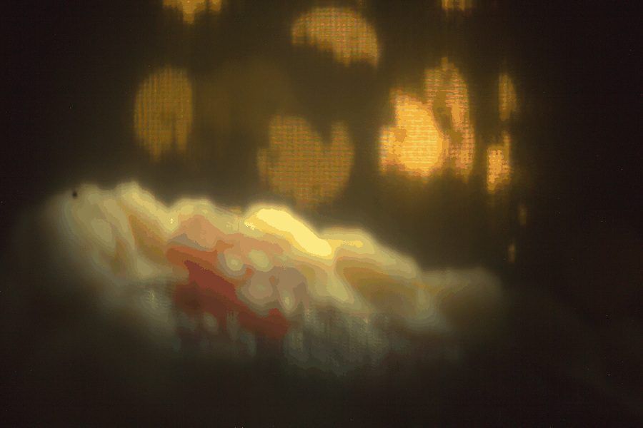

<div align="center">

# Dynamic Aperture Control with a Transmissive Liquid Crystal Display

**A programmable aperture and coded shutter for a Canon EOS 60D, built from a 1.8 inch LCD
panel and an Arduino Uno.**

MECH5720 Computational Imaging · The University of Sydney · 2026

[](https://www.python.org/)
[](App/Capturing/Ubuntu-System/arduino/aperture_panel)
[](#laptop-setup)
[](#camera-setup)
[](http://www.gphoto.org/)
[](LICENSE)

[](https://numpy.org/)
[](https://scipy.org/)
[](https://opencv.org/)
[](https://matplotlib.org/)
[](https://flask.palletsprojects.com/)
[](https://github.com/j-passmore/mech5720-2026-Dynamic-Aperture-Using-LCD/commits/main)

[Layout](#repository-layout) · [Parts](#parts-list) · [Build](#build) · [Setup](#laptop-setup) ·
[Capture](#capture-procedure) · [Figures](#regenerating-the-figures) · [Pitfalls](#known-pitfalls)

<table>
  <tr>
    <td align="center" width="50%"></td>
    <td align="center" width="50%"></td>
  </tr>
  <tr>
    <td align="center"><sub>LCD in front of the lens, 9.5 mm pupil</sub></td>
    <td align="center"><sub>LCD behind the lens, 5.5 mm pupil</sub></td>
  </tr>
</table>

<sub>The panel plays a walk cycle, one photo per frame. Every out-of-focus light behind the
subject takes the shape of the frame on the panel.</sub>

</div>

## Overview

A small liquid crystal display (LCD) sits in the light path of a Canon EOS 60D and acts as a
programmable aperture. An Arduino draws black and clear patterns on the panel. Each pattern
decides which parts of the lens pass light. The panel can also flicker in a binary code during
one exposure and become the shutter.

One Ubuntu laptop runs the panel and the camera. The group used the rig for four experiments:
depth estimation, post-capture refocus, custom bokeh and the flutter shutter. This page is the
build guide. The folder READMEs hold the detail: the capture app's manual and each experiment's
processing.

| Experiment | What the panel does | Status |
| --- | --- | --- |
| [Depth estimation](#depth-estimation) | Shows the coded aperture pair of Zhou, Lin and Nayar. |  |
| [Post-capture refocus](#post-capture-refocus) | Opens one tile of the aperture per photo in a 3x3 or 5x5 scan. |  |
| [Custom bokeh](#custom-bokeh) | Draws the shape every out-of-focus light takes. |  |
| [Flutter shutter](#flutter-shutter) | Plays a 32-chop binary code inside one exposure. |  |

## Repository layout

| Folder | Contents |
| --- | --- |
| [App/Capturing/Ubuntu-System](App/Capturing/Ubuntu-System) | The capture app: the server, the window, the command line client, the Arduino sketch, the masks and the sprites. [Its README](App/Capturing/Ubuntu-System/README.md) is the app manual. |
| [App/Processing/III-Custom_Bokeh](App/Processing/III-Custom_Bokeh) | The script that draws the bokeh figures and GIFs, with [its README](App/Processing/III-Custom_Bokeh/README.md). |
| [App/Processing/IV-Flutter_Shutter](App/Processing/IV-Flutter_Shutter) | The scripts that deblur and score the flutter photos and draw the key figures, with [their README](App/Processing/IV-Flutter_Shutter/README.md). |
| [App/Processing/I-Depth_Estimation](App/Processing/I-Depth_Estimation) and [II-Post_Capture_Reconstruction](App/Processing/II-Post_Capture_Reconstruction) | Empty. The depth and refocus code goes here. |
| [Captures](Captures) | The raw photos, one folder per experiment. The bokeh and flutter folders are full. |
| [Out](Out) | What the scripts write, one folder per experiment. |
| [Hardware-Modifications](Hardware-Modifications) | Photos of the parts. |

## Parts list

| Part | Use | Link |
| --- | --- | --- |
| Adafruit 1.8 inch TFT LCD, 128 x 160, ST7735R, product 358 | The panel is the aperture and the shutter. Its backlight comes off. | [adafruit.com/product/358](https://www.adafruit.com/product/358) |
| Arduino Uno Rev3 | The board draws each pattern on the panel. | [store.arduino.cc](https://store.arduino.cc/products/arduino-uno-rev3) |
| JJC AET-C25 automatic extension tube, 25 mm, Canon EF and EF-S | The tube holds the panel between the lens and the body through a slot cut in its side. | [jjc.cc](https://jjc.cc/index/goods/detail.html?id=631), bought on [eBay](https://www.ebay.com.au/itm/402972099293) |
| Canon EOS 60D | The camera takes every photo over USB. | |
| Canon EF-S 18-55 mm lens | The lens forms the image. The panel sits in front of it or behind it in the tube. | |
| Seven jumper wires and two USB cables | The wires link the panel to the board. One cable links the camera to the laptop and the other the board. | |
| Laptop running Ubuntu | The laptop runs the server and the window. | |
| Desk lamp on a direct current supply | The lamp lights the target. Mains lamps flicker at 100 Hz. | |
| Toy car with "95" on its side | The car is the moving target for the flutter shutter. | |
| String of small lights | The lights are the out-of-focus highlights for the custom bokeh. | |

<table>
  <tr>
    <td align="center" width="50%"></td>
    <td align="center" width="50%"></td>
  </tr>
  <tr>
    <td align="center"><sub>The JJC AET-C25 extension tube, 25 mm, for Canon EF and EF-S lenses.</sub></td>
    <td align="center"><sub>The Adafruit 358 panel, 1.8 inch and 128 x 160 pixels, as shipped.</sub></td>
  </tr>
</table>

## Build

1. Take the backlight off the panel. Light then passes through the glass. The LITE pin stays
   unconnected.
2. Wire the panel to the Uno with seven jumper wires. The breakout has its own regulator and
   level shifter. It takes 5 V on Vin and on the logic pins. SCK and MOSI are the Uno's
   hardware SPI pins. CS, D/C and RST are defines at the top of the sketch. Any output pin will
   do for those three.

   | Panel pin | Uno pin |
   | --- | --- |
   | Vin | 5V |
   | GND | GND |
   | SCK | 13 |
   | MOSI | 11 |
   | TFT_CS | 10 |
   | D/C | 8 |
   | RST | 9 |
   | LITE | not connected |

3. Upload the sketch. Install Adafruit GFX Library and Adafruit ST7735 and ST7789 Library from
   the Library Manager in the Arduino IDE, then upload
   [aperture_panel.ino](App/Capturing/Ubuntu-System/arduino/aperture_panel/aperture_panel.ino).
   The command line does the same:

   ```bash
   cd App/Capturing/Ubuntu-System
   arduino-cli lib install "Adafruit GFX Library" "Adafruit ST7735 and ST7789 Library"
   arduino-cli core install arduino:avr
   arduino-cli compile --fqbn arduino:avr:uno arduino/aperture_panel
   arduino-cli upload -p /dev/ttyACM0 --fqbn arduino:avr:uno arduino/aperture_panel
   ```

   The sketch prints `aperture 4 128 160` at 500000 baud on reset. The 4 is the protocol
   version. The server refuses any other. Upload the sketch again after every pull that changes
   it.
4. Mount the panel in one of two places. In front of the lens, tape the panel flat against the
   front of the lens with the glass across the beam. Inside the tube, cut a slot through the side
   of the extension tube, fit the tube between the lens and the body and slide the panel in
   through the slot.
5. Check the panel through the lens once the laptop is set up. Running the rig has the three
   checks.

## Laptop setup

Run these commands once.

```bash
cd App/Capturing/Ubuntu-System
./setup_laptop.sh
python3 -m venv .venv
.venv/bin/pip install -r requirements.txt
mkdir -p ~/.local/bin
curl -fL -o ~/.local/bin/dnglab https://github.com/dnglab/dnglab/releases/download/v0.8.0/dnglab_linux_x64
chmod +x ~/.local/bin/dnglab
```

[setup_laptop.sh](App/Capturing/Ubuntu-System/setup_laptop.sh) installs gphoto2, adds you to
`dialout` and removes three services that fight the rig for its devices. Known pitfalls says
which. dnglab turns each CR2 into a DNG for the Lab 3 MATLAB scripts, losslessly. `SAVE_DNG =
False` in `config.py` turns the DNGs off.

> [!NOTE]
> Log out and back in after setup so the `dialout` group takes effect. Until the next login the
> shell is not in `dialout`. Run the server under the group in the meantime:
>
> ```bash
> sg dialout -c ".venv/bin/python server.py --display arduino --camera gphoto"
> ```

## Camera setup

Put the 60D's mode dial on M and switch the lens to MF. Open the iris fully so the panel is the
stop. Set the quality to RAW+JPEG on the body. Turn off auto power off and long exposure noise
reduction in the menu. Plug the USB cable into the laptop and check that the laptop sees the
camera:

```bash
gphoto2 --auto-detect
gphoto2 --capture-image-and-download
```

## Running the rig

The rig runs in two terminals, both in `App/Capturing/Ubuntu-System/` with the venv active.
Start the server first:

```bash
cd App/Capturing/Ubuntu-System
source .venv/bin/activate
python server.py --display arduino --camera gphoto
```

The server prints `display=arduino camera=gphoto pupil 27.8 mm = 126.8 px` once the panel and
the camera are both up. Check the panel from the second terminal before the first run:

```bash
python show.py white --backend arduino
python show.py scan0 --backend arduino
```

1. `white` should fill the panel edge to edge. A strip of noise two pixels wide along one edge
   means the panel wants `INITR_GREENTAB` in the sketch.
2. `scan0` should light one corner tile. Write down which corner of the glass lights.
3. Look through the lens at `white` and `black`. A stripped panel may pass light where the image
   is black. Set `PANEL_INVERT = True` in `config.py` if it does and restart the server.

Start the window in the second terminal:

```bash
python camview_capture.py --outdir captures
```

The window shows the camera's live view, the image on the panel, the controls and one tab per
experiment. [The app manual](App/Capturing/Ubuntu-System/README.md) describes every control,
pattern and file.

> [!TIP]
> Tick Live view to frame the scene and untick it before a run, because it drains the camera
> battery.

## Capture procedure

Place the target and type its distance into Target distance mm in the Experiments window. Set
Repeats to 5 for the error bars. Press the button for the capture and follow the prompts. The
photos land in `captures/<experiment>/` with a manifest beside them.

### Depth estimation

Use a point source at each distance for PSF set. Use a textured target at each distance for
the rest.

- **PSF set** takes open, pattern A, pattern B, Levin and black.
- **Pair** takes open, A, B and open.
- **Singles** takes each coded pattern twice. One pattern then gets the exposure of the pair.
- **Card pair** takes the same four photos through hand-fitted cards with the panel white. The
  cards give the baseline for what the panel costs.

Patterns A and B start as `zhou_a` and `zhou_b`, the coded pair of Zhou, Lin and Nayar.

### Post-capture refocus

- **Scan 3x3** and **Scan 5x5** take open, every tile, black and open.
- **f/5.6 frame** takes one open disc 8.9 mm wide, the one-photo baseline.
- **Lens focus** pauses for you to focus the lens on the target by hand. It then takes the
  in-focus reference.

### Custom bokeh

An out-of-focus point of light takes the shape of the aperture. The panel draws the shape.
Every light behind the subject then becomes that shape. A walk cycle on the panel gives one
photo per frame. The app has no bokeh tab. The shapes go up as image patterns.
[sprites/](App/Capturing/Ubuntu-System/sprites) holds the Link, Mario and Knight frames the
group used, each a transparent character on black.

1. Stand a string of small lights well behind the subject and focus the lens on the subject.
   The lights must blur.
2. Open the iris. Set ISO 100 and 5 s on M.
3. Set Pupil mm to the stop the panel makes: 9.5 mm in front of the lens or 5.5 mm inside the
   tube.
4. Pick a sprite frame or GIF with Browse... or type a mask name. Press Capture and save. The
   command line runs a list:

   ```bash
   python capture_series.py --patterns open sprites/binary/mario/mario_binary_walk.gif open --label mario --outdir captures/bokeh --diameter 9.5
   python capture_series.py --patterns open levin nayar zhou_a zhou_b open --label masks --outdir captures/bokeh --diameter 9.5
   ```

5. Move the panel into the tube and repeat with `--diameter 5.5`.

### Flutter shutter

The flutter shutter of Raskar, Agrawal and Tumblin opens and closes the shutter in a binary code
during one exposure. The blur of a moving target then stays invertible. On this rig the panel is
the shutter. The camera takes one 5 s photo on M. The panel is black when the shutter opens. The
board then plays a 32-chop code of 100 ms chops from its own clock. The panel stays black until
the shutter closes.

1. Light the scene with lamps on a direct current supply.
2. On the Flutter tab leave the designed code. Set Chop ms to 100, pick Invert and press LCD
   only flutter shutter. Watch the panel go fully clear and fully dark in the code's pattern.
   Switch to Frame write if it never goes fully clear.
3. Set 5 s and ISO 100 on M. Set the aperture for the light level: f/5.6, f/11 or f/22.
4. Tick reference, impulse, coded and box. Set Repeats to 1 and press Run.
5. Follow the pop-ups. Stand the car still for the reference. Then drive it left at about
   100 px/s for the rest, starting with the "95" near the right edge.
6. Repeat at the other two apertures with the lamps, focus, zoom and track unchanged. Move the
   panel into the tube and repeat all three.

The command line takes one coded photo at a time at the shutter speed set on M:

```bash
python capture_series.py --code designed --chop 100 --no-capture --label switch --outdir captures/flutter
python capture_series.py --code designed --chop 100 --label coded --outdir captures/flutter
```

## Regenerating the figures

Each processing folder has a script that redraws its figures from the raw photos in `Captures/`
into `Out/`. Set up each folder's venv once with `python3 -m venv .venv` and
`.venv/bin/pip install -r requirements.txt`, then:

```bash
cd App/Processing/IV-Flutter_Shutter && .venv/bin/python flutter_figure.py     # two minutes
cd App/Processing/III-Custom_Bokeh && .venv/bin/python bokeh_figure.py          # half a minute
```


*The key figure: the coded photo, its deblur and the still reference at three light levels with
the LCD in front of the lens. The deblur at f/11 gives MSE 0.00122 against the reference.*


*The same three light levels with the LCD inside the extension tube.*


*Seven sprite frames as the panel showed them and the lights they shaped, in front of the lens
at a 9.5 mm pupil and behind the lens at 5.5 mm. The mesh in every light is the panel's pixel
grid.*


*The four masks laid out the same way.*

The flutter script prints the MSE of each deblur. All six match the scores the group saved. The
bokeh script also writes one GIF per character and panel position, which plays the walk as the
lights show it. It writes a table of the mesh pitch in each photo too. The two folder READMEs give the runs,
the blur lengths and the numbers.

## Known pitfalls

- **gphoto2 cannot claim the camera** when the desktop has mounted it as a drive.
  `setup_laptop.sh` masks the gvfs camera monitor and `server.py` kills it at start. If it
  happens anyway, run `pkill -f gvfs-gphoto2-volume-monitor` and `pkill -f gvfsd-gphoto2`.
- **ModemManager** probes a new serial device for a few seconds after it appears. The first
  connection to the board can fail. `setup_laptop.sh` removes it.
- **The brltty screen reader** claims CH340 bridges, the chip on Uno clones. The port
  disappears a moment after it appears. `setup_laptop.sh` removes brltty.
- **The shell joins `dialout`** only at the next login after setup. Use `sg dialout` until then.
- **A stripped panel** may pass light where the image is black. Set `PANEL_INVERT` in
  `config.py` to match what the lens shows.
- **The panel takes 15 to 35 ms to switch.** The flutter runs needed 100 ms chops and a 5 s
  exposure as a result.
- **Invert** may not take every panel fully clear. Watch LCD only flutter shutter before the
  first run.
- **Mains lighting** flickers at 100 Hz and adds its own code to every flutter photo. Use lamps
  on a direct current supply.
- **The panel's pixel grid** prints as a mesh in every bokeh highlight. A laser-cut card has no
  grid.
- **The LCD costs light.** The bokeh lights needed 5 s at ISO 100 through the panel.
- **Nobody could hold the car** at a steady speed for the whole 3.2 s code. Its speed wandered
  by 20 to 35 percent, which left most coded and box photos with unequal blur.
- **The score depends on where the car stands.** Its reflections change along the track. A
  photo taken 1,000 px from the reference spot scores worse however sharp it is.
- **LibRaw 0.22** reads the DNGs with a black level 40 to 100 counts too high, which darkens a
  photo by about 5 percent. The scripts read the CR2 instead.
- **The server** refuses a board on another protocol version. Upload the sketch again after
  every pull that changes it.

## References

1. R. Raskar, A. Agrawal and J. Tumblin, "Coded exposure photography: motion deblurring using
   fluttered shutter," *ACM Trans. Graph.*, vol. 25, no. 3, pp. 795-804, 2006.
   [doi:10.1145/1141911.1141957](https://doi.org/10.1145/1141911.1141957)
2. C. Zhou, S. Lin and S. K. Nayar, "Coded aperture pairs for depth from defocus," in *Proc.
   IEEE ICCV*, 2009, pp. 325-332.
   [doi:10.1109/ICCV.2009.5459268](https://doi.org/10.1109/ICCV.2009.5459268)
3. A. Levin, R. Fergus, F. Durand and W. T. Freeman, "Image and depth from a conventional camera
   with a coded aperture," *ACM Trans. Graph.*, vol. 26, no. 3, art. 70, 2007.
   [doi:10.1145/1276377.1276464](https://doi.org/10.1145/1276377.1276464)
4. H. Nagahara, C. Zhou, T. Watanabe, H. Ishiguro and S. K. Nayar, "Programmable aperture
   camera using LCoS," in *Proc. ECCV*, LNCS vol. 6316, 2010, pp. 337-350.
   [doi:10.1007/978-3-642-15567-3_25](https://doi.org/10.1007/978-3-642-15567-3_25)

## Licence

The [MIT Licence](LICENSE) covers this repository.
